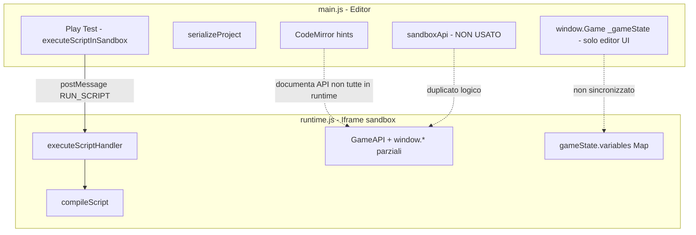
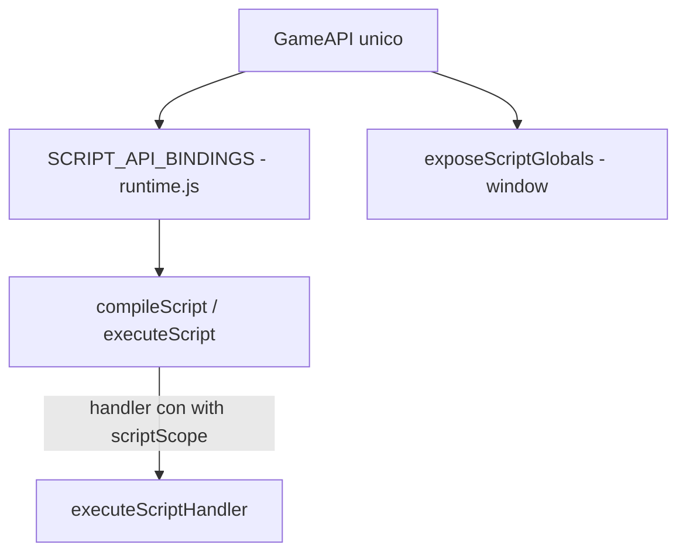

# Checklist tecnica — Unificazione API Editor ↔ Runtime

**Obiettivo:** una sola superficie API usabile da Play Test (`main.js` → iframe `runtime.js`), `runtime.html` standalone e documentazione (`README.md` / esempi script).

**Stato (maggio 2026):** Fasi **A**, **B**, **C** e pulizia **D** (parziale) completate in `runtime.js`. Gli script usano `getScriptApiBindings()` + `buildScriptExecutor()`; gli handler eseguono in `with (scriptScope)` via `buildHandlerExecutionScope()` / `runHandlerWithExecutionScope()`. `sandboxApi` e `gameInventory` editor sono stati rimossi da `main.js`.

**Residuo:** test manuali Fase E (incluso Script 4b `play_character_animation`); sync inventario in `UPDATE_CONTEXT`.

---

## Architettura attuale vs target



**Target:**



---

## Matrice API — dove vive oggi e cosa fare

Legenda azione:
- **Portare** → implementare in `runtime.js` (adattando a `gameState` / canvas)
- **Alias** → esporre nome documentato che delega a implementazione esistente
- **Rimuovere** → eliminare duplicato morto in `main.js` dopo migrazione
- **Tenere editor** → resta solo per editing canvas, non per Play Test

| API | main.js `sandboxApi` | runtime `GameAPI` | `window.*` runtime | In `compileScript` | Azione |
|-----|---------------------|-------------------|--------------------|--------------------|--------|
| `print` | ✅ | ✅ | ✅ | ✅ | Alias OK |
| `show_message` | ✅ (notification) | ✅ (`showText`) | ✅ | ✅ | Tenere runtime; editor può restare notification in UI |
| `move_object` | ✅ (editor canvas) | ✅ | ✅ | ❌ | **Portare** in bindings; già su GameAPI |
| `on_game_start` … `on_gui_click` | ✅ (editor handlers) | ✅ | parziale | ✅ (no-op compile) | Tenere runtime |
| `add_to_inventory` | ✅ | ❌ | ❌ | ❌ | **Portare** + `gameState.inventory` Map |
| `remove_from_inventory` | ✅ | ❌ | ❌ | ❌ | **Portare** |
| `has_item` | ✅ | ❌ | ❌ | ❌ | **Portare** |
| `get_item_count` | ✅ | ❌ | ❌ | ❌ | **Portare** |
| `clear_inventory` | ✅ | ❌ | ❌ | ❌ | **Portare** |
| `load_room` | ✅ (`selectRoom`) | ✅ | ✅ | ✅ | OK |
| `get_current_room` | ✅ | ✅ come `getCurrentRoom` | ❌ | ✅ come `getCurrentRoom` | **Alias** `get_current_room` |
| `get_room_objects` | ✅ | ❌ | ❌ | ❌ | **Portare** (leggere `gameState.currentRoom.objects`) |
| `set_room_background` | ✅ | ❌ | ❌ | ❌ | **Portare** (AssetRegistry + room) |
| `spawn_object` | ✅ | ❌ | ❌ | ❌ | **Portare** |
| `despawn_object` | ✅ | ❌ | ❌ | ❌ | **Portare** |
| `rotate_object` | ✅ | ❌ | ❌ | ❌ | **Portare** |
| `scale_object` | ✅ | ❌ | ❌ | ❌ | **Portare** |
| `set_object_visible` | ✅ | ❌ (`enableObject`/`disableObject`) | ❌ | ❌ | **Portare** o alias da enable/disable |
| `get_var` / `set_var` / `has_var` / `toggle_var` | ✅ → `window.Game` editor | ❌ | ❌ | ❌ | **Alias** su `getVariable`/`setVariable` + `Game.*` |
| `Game.getVar` … | ✅ editor `_gameState` | ❌ | `Game`=GameAPI senza getVar | ❌ | **Estendere GameAPI** o oggetto `Game` dedicato |
| `spawn_character` | ❌ (solo hints) | ✅ | ✅ | ❌ | **Bindings** + già globale |
| `move_character` | ❌ | ✅ | ✅ | ❌ | **Bindings** |
| `walk_character` | ❌ | ✅ | ✅ | ❌ | **Bindings** |
| `set_character_direction` | ❌ | ✅ | ✅ | ❌ | **Bindings** |
| `animate_character` | ❌ | ✅ | ✅ | ❌ | **Bindings** |
| `play_character_animation` | ❌ (hints ✅) | ✅ | ✅ | ❌ | **Implementato** — `GameAPI.play_character_animation`; coda comandi su `window` come `walk_character` |
| `enableObject` / `disableObject` | ❌ | ✅ | ❌ | ✅ | Documentare o unificare con `set_object_visible` |
| `enableHotspot` / `disableHotspot` | ❌ | ✅ | ❌ | ✅ | Campo `visible` hotspot; checkbox editor **Is active?** |
| `show_dialogue` | ❌ | ✅ | ✅ | ✅ | Balloon DialogBox; `characterIdOrName`, `text`; click dismiss |
| `show_dialogue_text` | ❌ | ✅ (alias) | ✅ | ✅ | `(text, speaker)` → delega a `show_dialogue` |
| `end_dialogue` | ❌ | ✅ | ✅ | ✅ | Chiude balloon attivo |

---

## Dialoghi — runtime (maggio 2026)

- [x] `GameAPI.show_dialogue(characterIdOrName, text)` — coda comandi, balloon segue personaggio
- [x] `show_dialogue_text(text, speaker)` — alias roadmap
- [x] `end_dialogue()`
- [x] Rendering da prima GUI `DialogBox` (colori, `balloon` asset, `appear`)
- [x] `getScriptApiBindings()` + `GAME_API_COMPLETIONS` in `main.js`
- [ ] `show_dialogue_choices`, `start_dialogue`, mood/relazioni — backlog

**Setup progetto:** tab GUI → tipo **DialogBox** → colori / immagine balloon.

**Esempio:**

```javascript
function on_character_click(character_id) {
  show_dialogue(character_id, "Buongiorno!");
}
```

---

## Animazioni personaggi — editor ↔ runtime

### Editor (`index.html` + `main.js`)
- **Walking (standard):** `character.directions` — 8 direzioni, frame, FPS, mirror.
- **Custom:** `character.animations[nome].directions` — stessa struttura; nome scelto dall’utente (non usare `walking`).
- UI: selettore Animation, pulsanti **+** / **−**, serializzazione in `serializeCharacters()`.

### Runtime (`runtime.js`)
- Caricamento: `loadCharacterDefinitions()` → `charDef.directions` + `charDef.animations`.
- Preload asset: frame in `directions` e in ogni `animations[*].directions`.
- Game loop: se `character.playingAnimation`, avanza frame da `animations[nome]`; al termine torna idle walking.
- Script: `play_character_animation(idOrName, animationName, direction, waitForCompletion?)`.

### Esempio script (Fase E)

```javascript
async function on_object_click(objectId, x, y) {
  await play_character_animation("Hero", "wave", "south");
  show_message("Done!");
}
```

- [ ] Animazione visibile; messaggio dopo il ciclo
- [ ] `walk_character` interrompe animazione custom in corso

---

## File per file

### 1. `JS/runtime.js` (priorità massima)

#### 1.1 Stato — aggiungere a `gameState` (~riga 20)

- [ ] `inventory: new Map()` — `itemId → count` (runtime gameplay, non definizioni oggetti UI)
- [ ] Opzionale: `inventoryItems: Map()` — definizioni da `projectData.inventory` (nome → metadata/icona) al load
- [ ] In `initRuntime` / load progetto: **non** confondere `projectData.inventory` (lista definizioni da editor) con stato runtime

#### 1.2 Modulo inventario (nuova sezione, dopo GameAPI o prima)

Portare logica da `main.js` `sandboxApi` 7237–7273 + `persistInventory` 5979–5999, adattata:

| Funzione sorgente (`main.js`) | Implementazione runtime |
|------------------------------|-------------------------|
| `add_to_inventory` | `gameState.inventory.set`, risolvere itemId da nome se necessario |
| `remove_from_inventory` | come sopra |
| `has_item` / `get_item_count` / `clear_inventory` | lettura Map |
| `persistInventory` | `localStorage` chiave `amiantoRuntimeInventory_${projectId}` o incluso in save-game futuro |

- [ ] Aggiungere metodi su `GameAPI`
- [ ] Non usare `showNotification` — usare `log()` / `showGameMessage` opzionale

#### 1.3 Modulo oggetti stanza

Portare da `main.js` 7365–7477, target `gameState.currentRoom.objects[]` (struttura già usata da rendering/hit test):

| Funzione | Note implementazione runtime |
|----------|------------------------------|
| `spawn_object` | `uid()`, push in `currentRoom.objects`, caricare img via `AssetRegistry` o URL |
| `despawn_object` | filter by id |
| `rotate_object` | campo `rotation` (gradi) — allineare a schema oggetto runtime |
| `scale_object` | `scaleX` / `scaleY` |
| `set_object_visible` | `visible` + `enabled` |

- [ ] Verificare campi oggetto in load room (~loader oggetti) per coerenza nomi

#### 1.4 Stanze — API mancanti

| Funzione | Sorgente `main.js` | Runtime |
|----------|-------------------|---------|
| `get_room_objects` | 7300–7313 | Mappare `gameState.currentRoom.objects` |
| `set_room_background` | 7315–7361 | Impostare `room.background` + `AssetRegistry` |

#### 1.5 Variabili — alias `Game`

Da `main.js` `window.Game` 6953–7022 (validazione tipi da `gameVariableDefinitions`):

- [ ] Aggiungere su `GameAPI`: `getVar`, `setVar`, `hasVar`, `toggleVar` (delegano a `gameState.variables`)
- [ ] Opzionale: caricare definizioni variabili da `projectData.variables` per validazione tipo come in editor
- [ ] Esporre alias globali: `get_var`, `set_var`, `has_var`, `toggle_var`
- [ ] **Non** sostituire `window.Game = GameAPI` ciecamente se servono metodi extra — usare `Object.assign(GameAPI, { getVar, setVar, ... })`

#### 1.6 `exposeScriptGlobals()` (nuova funzione, dopo definizione `GameAPI` ~3400)

- [ ] Iterare `SCRIPT_API_BINDINGS` e assegnare `window[name] = binding.fn`
- [ ] Chiamare dopo `initRuntime` e dopo `RESET` message handler
- [ ] Eliminare duplicazioni manuali sparse (3411–3468) sostituite da loop

#### 1.7 Refactor `compileScript` (~1593–1861)

**Problema:** gli handler sono closure sullo scope del `new Function`; le API devono essere **parametri** della funzione di compilazione, non solo globali (le globali aiutano ma non bastano in strict mode futuro / CSP).

**Implementazione consigliata:**

```javascript
// Esempio struttura (da inserire in runtime.js)

const SCRIPT_API_BINDINGS = [
  { name: 'print', fn: () => GameAPI.print.bind(GameAPI) },
  { name: 'Game', fn: () => GameAPI },
  { name: 'GameAPI', fn: () => GameAPI },
  { name: 'getVariable', fn: () => GameAPI.getVariable.bind(GameAPI) },
  { name: 'setVariable', fn: () => GameAPI.setVariable.bind(GameAPI) },
  { name: 'get_var', fn: () => GameAPI.getVar.bind(GameAPI) },
  // ... tutte le API pubbliche ...
  { name: 'add_to_inventory', fn: () => GameAPI.add_to_inventory.bind(GameAPI) },
  { name: 'spawn_character', fn: () => GameAPI.spawn_character.bind(GameAPI) },
  { name: 'play_character_animation', fn: () => GameAPI.play_character_animation.bind(GameAPI) },
  // handler names NON vanno qui — gestiti a parte come ora
];

function buildScriptFunction(scriptBody, options) {
  const { handlerNames = [], useNoOpHandlers = false } = options;
  const apiParams = SCRIPT_API_BINDINGS.map(b => b.name);
  const handlerParams = handlerNames; // on_game_start, ...
  const params = [...apiParams, ...handlerParams, 'handlerContainer'];

  const fn = new Function(...params, scriptBody);
  const apiArgs = SCRIPT_API_BINDINGS.map(b => b.fn());
  const handlerArgs = handlerNames.map(h =>
    useNoOpHandlers ? createNoOpHandler(h) : GameAPI[h].bind(GameAPI)
  );
  return { fn, args: [...apiArgs, ...handlerArgs, handlerContainer] };
}
```

Checklist:

- [ ] Creare `SCRIPT_API_BINDINGS` (unica fonte verità)
- [ ] Refactor `compileScript` per usare `buildScriptFunction(processedContent, { useNoOpHandlers: true })`
- [ ] Refactor `executeScript` (~1952) con stesso builder, `useNoOpHandlers: false`
- [ ] Mantenere preprocessing async sugli handler (`supportedHandlers` ~1612)
- [ ] Mantenere estrazione handler in `handlerContainer` (~1741–1746)

#### 1.8 Handler wrapper — scope API in esecuzione ✅ (Fase C)

- [x] `buildHandlerExecutionScope()` — API da `getScriptApiBindings()` + getter/setter variabili (ricostruito a ogni invocazione)
- [x] `runHandlerWithExecutionScope()` — `with (scriptScope)` senza `handlerFunc.toString()`
- [ ] Test manuale: handler con `await walk_character(...)` + `add_to_inventory(...)` nello stesso script

#### 1.9 `executeScriptHandler` / `RUN_SCRIPT`

- [x] `RUN_SCRIPT` ignorato se `handlerName` mancante
- [x] `executeScriptInSandbox` invia `scriptName` stabile nel postMessage
- [x] `executeScriptHandler` attende Promise restituite dagli handler

#### 1.10 Reset e load

- [x] `RESET`: clear `gameState.inventory`, `compiledScripts`
- [ ] `initRuntime`: opzionale reset inventario da save slot futuro

---

### 2. `JS/main.js`

#### 2.1 Rimuovere / deprecare codice morto

| Elemento | Righe circa | Azione |
|----------|-------------|--------|
| `const sandboxApi = { ... }` | — | [x] **Rimosso** |
| `executeScriptHandler` stub editor | — | [x] Non presente (solo iframe) |
| `triggerGameEvent` / `gameEventHandlers` editor | — | [ ] Verificare se ancora usati in canvas editor |

#### 2.2 `gameInventory` editor ✅

| Azione | Dettaglio |
|--------|-----------|
| [x] Rimosso `gameInventory`, `persistInventory`, `amiantoGameInventory` da editor |
| [x] Play Test: stato inventario solo in `runtime.js` (`gameState.inventory`) |

#### 2.3 `window.Game` editor (~6953–7022)

- [ ] **Tenere** per tab Variables UI in editor
- [ ] Play Test: sincronizzare variabili editor → runtime via `UPDATE_CONTEXT` (~9002) **prima** di ogni script
- [ ] Dopo handler runtime: sync runtime → editor se si modifica stato in gioco (opzionale, fase 2)

#### 2.4 Play Test — `executeScriptInSandbox` (~8954–9000)

- [ ] Inviare `scriptName` stabile (chiave `jsScripts`) nel postMessage, non solo hash temporaneo
- [ ] Includere in `UPDATE_CONTEXT`: snapshot variabili **e** inventario runtime (dopo implementazione)
- [x] `on_room_change` allineato in editor e runtime (non più `on_room_enter`)

#### 2.5 CodeMirror hints (~6040–6047)

- [x] `GAME_API_COMPLETIONS`: dialoghi (`show_dialogue`, `show_dialogue_text`, `end_dialogue`) — maggio 2026
- [ ] Allineare elenco completo con ogni nuova API in `getScriptApiBindings()`
- [ ] Opzionale: generare lista da documentazione conmotion

#### 2.6 Serializzazione progetto (~11881)

- [ ] `inventory` nel JSON = definizioni oggetti (nomi), non stato runtime — documentare
- [ ] Futuro: `initialInventory` in progetto o variabile di gioco

---

### 3. `index.html` / `runtime.html`

- [ ] Nessun cambio obbligatorio per unificazione API
- [ ] Verificare che Play Test iframe carichi solo `runtime.js` (già sandbox)

---

### 4. Documentazione

| File | Azione |
|------|--------|
| `README.md` | [ ] Allineare elenco 24+ API con `SCRIPT_API_BINDINGS` |
| `ROADMAP.md` | [ ] Segnare gap API editor/runtime; aggiornare Fase 1.5 |
| `# 🎮 Funzioni da Implementare - Amianto editor.md` | [ ] Nota: backlog futuro, non stato attuale |

---

## Piano `compileScript` — passi implementativi

### Fase A — Infrastruttura (1–2 giorni) ✅ COMPLETATA (maggio 2026)

1. [x] Definire `getScriptApiBindings()` in `runtime.js` (fonte unica binding)
2. [x] Implementare `buildScriptExecutor()` + refactor `compileScript` / `executeScript`
3. [x] Implementare `exposeScriptGlobals()`
4. [ ] Smoke `add_to_inventory` — previsto dopo Fase B.1 (API non ancora nel runtime)

### Fase B — Port API mancanti ✅ (maggio 2026)

5. [x] Inventario su `gameState.inventory`
6. [x] Oggetti: spawn/despawn/rotate/scale/visible
7. [x] `get_room_objects`, `set_room_background`
8. [x] Alias variabili `get_var` / `Game.getVar`

### Fase C — Scope handler ✅ (maggio 2026)

9. [x] `compileScript` usa `buildScriptExecutor`
10. [x] `executeScript` usa `buildScriptExecutor`
11. [x] Handler wrapper: `buildHandlerExecutionScope` + `runHandlerWithExecutionScope`

### Fase D — Pulizia editor ✅ (maggio 2026)

12. [x] `sandboxApi` rimosso
13. [x] `on_room_change` in Play Test
14. [x] `scriptName` stabile in postMessage (`executeScriptInSandbox`)

### Fase E — Test manuali

Vedi sezione Test sotto.

---

## Dettaglio porting funzioni — `main.js` → `runtime.js`

### Inventario

**Sorgente:** `main.js` 7237–7273, storage 5979–5999

```text
gameState.inventory: Map<string, number>

GameAPI.add_to_inventory(itemId, quantity?)
  → normalizza id, incrementa, log, return count

GameAPI.remove_from_inventory(...)
GameAPI.has_item(itemId) → boolean
GameAPI.get_item_count(itemId) → number
GameAPI.clear_inventory() → true
```

**Non copiare:** `showNotification` — usare `GameAPI.print` o overlay.

### Oggetti

**Sorgente:** `main.js` 7365–7477

**Differenze da gestire:**

| Editor | Runtime |
|--------|---------|
| `sceneObjects` array globale | `gameState.currentRoom.objects` |
| `rotationRad` | verificare se runtime usa gradi o radianti |
| `redraw()` | game loop `render()` automatico |
| placeholder canvas 32×32 | riusare pattern in `renderCharacterPlaceholder` |

### Stanze

**Sorgente:** `get_room_objects` 7300–7313, `set_room_background` 7315–7361

- `get_room_objects`: return plain objects `{ id, name, x, y, visible, ... }`
- `set_room_background`: accetta URL o assetId già in `AssetRegistry`

### Variabili

**Sorgente:** `main.js` 6962–7022, alias sandbox 7480–7491

```javascript
GameAPI.getVar = (key) => GameAPI.getVariable(key);
GameAPI.setVar = (key, val) => { GameAPI.setVariable(key, val); return true; };
// hasVar, toggleVar analoghi
```

Validazione tipo: copiare blocco `gameVariableDefinitions` solo se le definizioni sono caricate in runtime da `projectData.variables`.

---

## Bug noti da includere nel lavoro

| # | Problema | File | Fix |
|---|----------|------|-----|
| 1 | `on_room_enter` vs `on_room_change` | main.js ~9068 | Usare `on_room_change` |
| 2 | `window.Game` senza `getVar` | runtime.js ~3404 | Estendere GameAPI |
| 3 | `sandboxApi` mai usato | main.js 7133+ | Rimuovere |
| 4 | Handler non vedono API non iniettate | compileScript | Bindings + scriptScope |
| 5 | `RUN_SCRIPT` senza `scriptName` stabile | main.js 8987 | Passare nome script editor |

---

## Test di accettazione (Play Test)

Eseguire ogni script come handler globale o su hotspot dopo unificazione.

### Script 1 — Variabili

```javascript
function on_game_start() {
  Game.setVar("intro", true);
  print("intro=", Game.getVar("intro"));
}
```

- [ ] Nessun errore in Script Log
- [ ] Valore visibile in log runtime

### Script 2 — Inventario

```javascript
function on_hotspot_click(hotspotId) {
  add_to_inventory("chiave", 1);
  if (has_item("chiave")) {
    show_message("Hai la chiave!");
  }
}
```

- [ ] `has_item` true dopo click
- [ ] Stato sopravvive tra click (Map runtime)

### Script 3 — Oggetti

```javascript
function on_object_click(objectId, x, y) {
  spawn_object("barile", x + 40, y);
  move_object(objectId, x, y - 20);
}
```

- [ ] Oggetto visibile e cliccabile nel canvas

### Script 4 — Personaggi async

```javascript
async function on_game_start() {
  const id = spawn_character("Eroe", 200, 300, "south");
  await walk_character(id, 400, 300);
  show_message("Arrivato!");
}
```

- [ ] Movimento visibile; messaggio dopo walk

### Script 4b — Animazione custom

Prerequisito: in editor, character `Eroe` (o `Hero`) con animazione custom `wave` e frame per `south`.

```javascript
async function on_hotspot_click(hotspotId) {
  await play_character_animation("Eroe", "wave", "south");
  show_message("Animazione finita");
}
```

- [ ] Ciclo `wave` visibile; posa idle walking dopo
- [ ] Con `await`, `show_message` solo a fine animazione

### Script 5 — Stanza

```javascript
function on_hotspot_click() {
  load_room("Stanza2");
  print("Oggetti:", get_room_objects().length);
}
```

- [ ] Cambio stanza + log count

---

## Ordine di merge consigliato

1. `SCRIPT_API_BINDINGS` + refactor compile (senza nuove API) — verifica regressioni eventi esistenti  
2. Alias variabili + `get_room_objects`  
3. Inventario runtime  
4. Oggetti runtime  
5. Pulizia `main.js` + fix `on_room_enter`  
6. Aggiornamento README / ROADMAP  

---

## Riferimenti righe codice (snapshot)

| Area | File | Righe |
|------|------|-------|
| `gameState` | runtime.js | 20–40 |
| `compileScript` | runtime.js | 1593–1861 |
| `executeScript` | runtime.js | 1952–2025 |
| `executeScriptHandler` | runtime.js | 2041–2087 |
| `GameAPI` | runtime.js | 2834–3400 |
| Esposizione globale parziale | runtime.js | 3402–3468 |
| `sandboxApi` (dead) | main.js | 7133–7499 |
| `gameInventory` editor | main.js | 5969–6000 |
| `window.Game` editor | main.js | 6953–7022 |
| Play Test postMessage | main.js | 8954–9070 |
| CodeMirror API list | main.js | 6040–6047 |
| RUN_SCRIPT handler | runtime.js | 4409–4428 |

---

*Documento generato per il progetto Amianto Editor — unificazione API scripting.*
