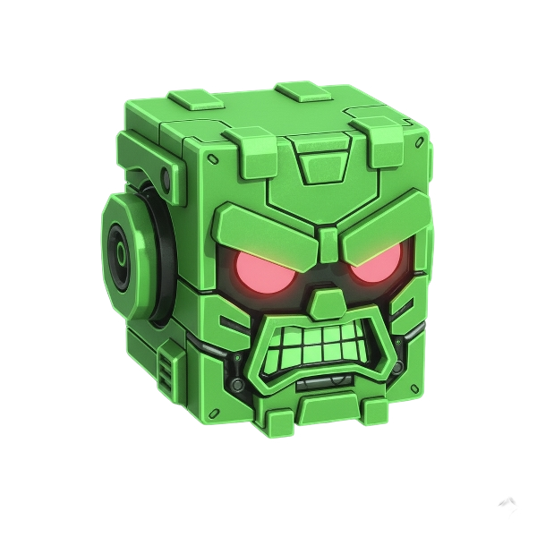

<p align="center">
  
</p>

# Amianto Editor

Modern web-based point'n'click game editor. Design rooms, place scene objects, draw walkable areas, manage characters and animations, and script behaviors with JavaScript — all in your browser.

## Features (already implemented)

- Rooms Manager
  - Create, rename, delete, and switch rooms
  - Per-room assets: background, foreground layers, scene objects, walkable area
- Canvas Workspace (context-aware)
  - Rooms: renders background, scene objects, foregrounds, walkable overlay
  - Characters: preview animation frames in the main canvas
  - Scripts: editor-focused canvas
  - Canvas controls: zoom in/out, reset to 100%, fit to screen, center view
- Walkable Area (Level Design)
  - Click-to-add polygon vertices (Start/Finish/Clear/Show/Hide)
  - Select/move/delete vertices; per-room shape stored in project state
- Hotspots
  - Create polygonal hotspots; add/finish/clear points; show/hide all
  - Select/move/delete vertices; list and manage hotspots
- Scene Objects (Rooms)
  - Add image-based objects; edit name and position; delete
  - List with filtering and type badges
- Foreground Layers
  - Multiple image layers; list and ordering controls
- Characters
  - Create characters; 8-direction setup
  - Upload multiple animation frames per direction; FPS control; preview
  - Game start configuration: choose starting player, room and position
- Inventory Objects
  - Manage items (upload, filter, edit, delete)
  - Grid size controls (width/height)
- GUI Editor
  - Create GUIs; background images
  - Draw, move and delete buttons; list buttons
- Contextual Cursors
  - Define cursor per target type (hotspot/character/scene object)
  - Upload cursor image, optional action text; list active cursors
- Scripting (JavaScript, Jailed sandbox)
  - Built‑in editor (CodeMirror) with syntax highlighting
  - Exposed APIs: `print(...)`, `show_message(text)`, `move_object(id, x, y)`
  - Attach scripts to rooms, characters, scene objects, inventory, GUI buttons, hotspots and cursors
  - Save/Load scripts, Run/Stop sandbox
- Play Test Panel
  - Start/Pause/Stop test session; debug console; quick test actions
- Authentication & Projects
  - Login/logout, registration modal, persistent sessions, demo account
  - Per-user project storage, debug tools (Reset Demo, Debug Auth, Force Reset)
- File Menu
  - New/Open/Save/Export, Project Settings, Delete Project
- Standalone Runtime
  - `runtime.html` loads and renders exported JSON via `JS/runtime.js`
  - Load JSON file, load last saved (OPFS/localStorage), download JSON
  - Auto-try `game.json` at startup; shows runtime logs
- Theming
  - Acid dark + neon UI across forms, buttons, lists, dropdowns

## Quick Start

1. Open `index.html` in a modern browser.
2. Rooms → Rooms Manager: create/select a room.
3. Add a Background and optional Foreground Layers.
4. Scene Objects → add images; edit positions as needed.
5. Walkable Area → Start Drawing → click to add vertices → Finish.
6. Characters → select a character → upload animation frames → Start Preview.
7. Scripts → write JavaScript and Run; use the provided APIs.
8. Play → Start Test to see runtime logs and basic flow.

## Keyboard & Tips

- Tabs: Ctrl+1..5 to switch quickly
- Scripts: Ctrl+S saves the current script
- Zoom editor (Rooms/Characters): mouse wheel (bounded zoom)

## Project Structure

- `index.html` — Editor UI layout (login, dashboard, tabs and sections)
- `CSS/main.css` — Acid dark theme and neon styling
- `JS/main.js` — Editor engine: tabs, canvas, rooms/objects, characters, scripting, UI handlers
- `runtime.html` — Standalone runtime player
- `JS/runtime.js` — Runtime renderer (rooms/assets, start room, OPFS/localStorage)
- `README_AUTH_TESTING.md` — Auth system testing guide
- `# 🎮 Funzioni da Implementare - Amianto editor.md` — Full list of APIs to implement
- `img/cover.png` — Project cover (shown above)

## Extending

### 🚀 JavaScript API Roadmap

#### **Phase 1 - Core Systems (High Priority)**
- **Event System**: `on_game_start()`, `on_room_change()`, `on_object_click()`, `on_character_click()`, `on_hotspot_click()`
- **Inventory System**: `add_to_inventory()`, `remove_from_inventory()`, `has_item()`, `get_item_count()`, `clear_inventory()`
- **Object System**: `spawn_object()`, `despawn_object()`, `rotate_object()`, `scale_object()`, `set_object_visible()`
- **Room System**: `load_room()`, `get_current_room()`, `get_room_objects()`, `set_room_background()`

#### **Phase 2 - Advanced Interactions (Medium Priority)**
- **Dialogue System**: `start_dialogue()`, `show_dialogue_text()`, `show_dialogue_choices()`, `get_character_mood()`
- **Audio System**: `play_music()`, `play_sound()`, `set_music_volume()`, `play_ambient_sound()`
- **Character System**: `spawn_character()`, `move_character()`, `animate_character()`, `set_character_ai()`
- **Visual System**: `fade_in()`, `fade_out()`, `transition_to_room()`, `show_cutscene()`

#### **Phase 3 - Advanced Features (Low Priority)**
- **Game System**: `get_game_variable()`, `set_game_variable()`, `save_game()`, `load_game()`, `add_score()`
- **UI System**: `show_tooltip()`, `show_notification()`, `open_menu()`, `show_modal()`
- **Debug System**: `log_info()`, `log_warning()`, `log_error()`, `show_debug_info()`
- **Utility System**: `distance()`, `angle_between()`, `format_string()`, `shuffle_array()`

### 🔧 Technical Implementation

#### **Recommended API Structure**
```javascript
// Exposure in Jailed sandbox
window.gameAPI = {
    // Events
    onGameStart: function() { /* implementation */ },
    onObjectClick: function(objectId, x, y) { /* implementation */ },
    
    // Inventory
    addToInventory: function(itemId, quantity) { /* implementation */ },
    hasItem: function(itemId) { /* implementation */ },
    
    // Objects
    spawnObject: function(objectId, x, y) { /* implementation */ },
    moveObject: function(objectId, x, y) { /* implementation */ }
};
```

#### **Development Considerations**
- Implement functions gradually following priority order
- Test each new API before proceeding to the next
- Maintain compatibility with existing system
- Document every added function with usage examples
- Use existing notification system for user feedback

#### **Related Features**
- Data persistence: serialize `rooms` map and game state to localStorage
- Drag-and-drop: editing tools for objects and walkable vertices
- Save system: implement complete project save/load functionality
- Export/Import: features for sharing projects between users

### 📋 Implementation Checklist

- [ ] **Phase 1**: Core event system and inventory
- [ ] **Phase 1**: Advanced object and room management  
- [ ] **Phase 2**: Dialogue and audio systems
- [ ] **Phase 2**: Character management and visual effects
- [ ] **Phase 3**: Complete game system and advanced UI
- [ ] **Phase 3**: Debug tools and utility functions
- [ ] **Bonus**: Data persistence and project export/import

See `# 🎮 Funzioni da Implementare - Amianto editor.md` for the complete list of functions to implement.

---

# Amianto Editor (Italiano)

Editor web moderno per giochi punta‑e‑clicca. Progetta stanze, posiziona oggetti di scena, disegna le zone camminabili, gestisci personaggi e animazioni, e crea comportamenti con script JavaScript — tutto nel browser.

## Funzionalità (già presenti)

- Gestione Stanze
  - Crea, rinomina, elimina e seleziona stanze
  - Dati per stanza: background, livelli di foreground, oggetti di scena, zona camminabile
- Canvas (contestuale alla tab)
  - Rooms: render di background, oggetti, foreground e overlay walkable
  - Characters: anteprima frame d’animazione sul canvas principale
  - Scripts: canvas dedicato all’editor
  - Controlli canvas: zoom +/−, reset 100%, Fit, Center
- Zona Camminabile (Level Design)
  - Clic per aggiungere vertici del poligono (Start/Finish/Clear/Show/Hide)
  - Selezione/spostamento/eliminazione vertici; poligono salvato per stanza
- Hotspot
  - Crea hotspot poligonali; aggiungi/termina/svuota punti; mostra/nascondi tutti
  - Selezione/spostamento/eliminazione vertici; lista hotspot
- Oggetti di Scena
  - Aggiunta immagini; modifica nome/posizione; rimozione
  - Supporto per più oggetti con stessa immagine (nomi unici)
  - Lista con filtro e badge (Interactive, Container, ecc.)
- Livelli di Foreground
  - Più livelli immagine con ordinamento
- Personaggi
  - Creazione personaggi; setup 8 direzioni
  - Upload multiplo frame per direzione; controllo FPS; anteprima
  - Configurazione avvio gioco: personaggio/room/posizione iniziali
- Oggetti di Inventario
  - Gestione item inventario (upload, filtro, modifica, elimina)
  - Supporto per più oggetti con stessa immagine (nomi unici)
- Editor GUI
  - Crea elementi GUI con immagini di sfondo
  - Disegna, sposta e cancella pulsanti; lista pulsanti
- Cursori Contestuali
  - Definisci cursori per tipo target (hotspot/personaggio/oggetto scena)
  - Upload immagine cursore, testo azione opzionale; lista cursori attivi
- Scripting (JavaScript, sandbox Jailed)
  - Editor JavaScript integrato (CodeMirror)
  - API esposte: `print(...)`, `show_message(text)`, `move_object(id, x, y)`
  - Collega script a stanze, personaggi, oggetti di scena, inventario, GUI, hotspot e cursori
  - Salva/Carica script, Esegui/Stop sandbox
- Play Test
  - Avvio/Pausa/Stop; console di debug; azioni test rapide
- Autenticazione & Progetti
  - Login/logout, registrazione, sessioni persistenti, utente demo
  - Progetti per utente, strumenti di debug (Reset Demo, Debug Auth, Force Reset)
- Menu File
  - Nuovo/Apri/Salva/Export, Impostazioni Progetto, Elimina Progetto
- Runtime Standalone
  - `runtime.html` + `JS/runtime.js` per caricare/eseguire JSON di progetto
  - Carica file JSON, Carica ultimo salvataggio (OPFS/localStorage), Download JSON
  - Tentativo automatico di caricare `game.json` all’avvio; log runtime
- Tema
  - Interfaccia acid dark + neon uniforme (form, pulsanti, liste, menu)

## Avvio Rapido

1. Apri `index.html` in un browser recente.
2. Rooms → Rooms Manager: crea/seleziona una stanza.
3. Aggiungi un Background e, se vuoi, livelli di Foreground.
4. Scene Objects → aggiungi immagini; modifica le posizioni.
5. Walkable Area → Start Drawing → clic per i vertici → Finish.
6. Characters → seleziona un personaggio → carica i frame → Start Preview.
7. Scripts → scrivi JavaScript e premi Run; usa le API fornite.
8. Play → Start Test per vedere i log e provare il flusso.

## Note & Consigli

- Cambio tab: Ctrl+1..5
- Scripts: Ctrl+S salva lo script
- Zoom editor (Rooms/Characters): rotella mouse

## Struttura del Progetto

- `index.html` — Editor (login, dashboard, tabs/sezioni)
- `CSS/main.css` — Tema scuro neon
- `JS/main.js` — Motore editor: tabs, canvas, stanze/oggetti, personaggi, scripting, UI
- `runtime.html` — Player runtime standalone
- `JS/runtime.js` — Renderer runtime (stanze/assets, start room, OPFS/localStorage)
- `README_AUTH_TESTING.md` — Guida al testing dell’autenticazione
- `# 🎮 Funzioni da Implementare - Amianto editor.md` — Lista completa API da implementare
- `img/cover.png` — Cover (in alto)

## Estensioni Possibili

### 🚀 Roadmap JavaScript API

#### **Fase 1 - Sistema Base (Priorità Alta)**
- **Sistema Eventi**: `on_game_start()`, `on_room_change()`, `on_object_click()`, `on_character_click()`, `on_hotspot_click()`
- **Sistema Inventario**: `add_to_inventory()`, `remove_from_inventory()`, `has_item()`, `get_item_count()`, `clear_inventory()`
- **Sistema Oggetti**: `spawn_object()`, `despawn_object()`, `rotate_object()`, `scale_object()`, `set_object_visible()`
- **Sistema Stanze**: `load_room()`, `get_current_room()`, `get_room_objects()`, `set_room_background()`

#### **Fase 2 - Interazioni Avanzate (Priorità Media)**
- **Sistema Dialoghi**: `start_dialogue()`, `show_dialogue_text()`, `show_dialogue_choices()`, `get_character_mood()`
- **Sistema Audio**: `play_music()`, `play_sound()`, `set_music_volume()`, `play_ambient_sound()`
- **Sistema Personaggi**: `spawn_character()`, `move_character()`, `animate_character()`, `set_character_ai()`
- **Sistema Visivo**: `fade_in()`, `fade_out()`, `transition_to_room()`, `show_cutscene()`

#### **Fase 3 - Funzionalità Avanzate (Priorità Bassa)**
- **Sistema Gioco**: `get_game_variable()`, `set_game_variable()`, `save_game()`, `load_game()`, `add_score()`
- **Sistema UI**: `show_tooltip()`, `show_notification()`, `open_menu()`, `show_modal()`
- **Sistema Debug**: `log_info()`, `log_warning()`, `log_error()`, `show_debug_info()`
- **Sistema Utilità**: `distance()`, `angle_between()`, `format_string()`, `shuffle_array()`

### 🔧 Implementazione Tecnica

#### **Struttura API Consigliata**
```javascript
// Esposizione nel sandbox Jailed
window.gameAPI = {
    // Eventi
    onGameStart: function() { /* implementazione */ },
    onObjectClick: function(objectId, x, y) { /* implementazione */ },
    
    // Inventario
    addToInventory: function(itemId, quantity) { /* implementazione */ },
    hasItem: function(itemId) { /* implementazione */ },
    
    // Oggetti
    spawnObject: function(objectId, x, y) { /* implementazione */ },
    moveObject: function(objectId, x, y) { /* implementazione */ }
};
```

#### **Considerazioni di Sviluppo**
- Implementare gradualmente le funzioni seguendo l'ordine di priorità
- Testare ogni nuova API prima di procedere alla successiva
- Mantenere compatibilità con il sistema esistente
- Documentare ogni funzione aggiunta con esempi d'uso
- Utilizzare il sistema di notifiche esistente per feedback utente

#### **Funzionalità Correlate**
- Persistenza dati: serializzare `rooms` map e stato gioco in localStorage
- Drag-and-drop: strumenti di editing per oggetti e vertici walkable
- Sistema di salvataggio: implementare save/load completo del progetto
- Export/Import: funzionalità per condividere progetti tra utenti

### 📋 Checklist Implementazione

- [ ] **Fase 1**: Sistema eventi base e inventario
- [ ] **Fase 1**: Gestione oggetti e stanze avanzata  
- [ ] **Fase 2**: Sistema dialoghi e audio
- [ ] **Fase 2**: Gestione personaggi e effetti visivi
- [ ] **Fase 3**: Sistema gioco completo e UI avanzata
- [ ] **Fase 3**: Debug tools e funzioni di utilità
- [ ] **Bonus**: Persistenza dati e export/import progetti

Vedi `# 🎮 Funzioni da Implementare - Amianto editor.md` per la lista completa delle funzioni da implementare.

## Roadmap (integrazioni possibili)

### Fase 1 — Migliorie core
- Sistema eventi completo (click/hover oggetti, cambi stanza, avvio gioco)
- Pathfinding su zona camminabile e click-to-move del personaggio
- Undo/Redo globale, multi‑selezione, snap‑to‑grid, guide e allineamenti
- Ordinamento livelli/oggetti (z‑index, y‑sorting), parallax per foreground
- Asset manager con drag&drop e deduplica, anteprime

### Fase 2 — Gameplay e contenuti
- Sistema dialoghi ramificati con scelte e condizioni
- Audio: musica di fondo, SFX, suoni ambientali con mixer/volumi
- Inventario avanzato con combinazioni, uso su hotspot/oggetti
- Sistema personaggi: movimento, animazioni per stato, AI semplice (patrol/follow)
- Effetti visivi: fade/transition, particellari, cutscene

### Fase 3 — Scripting & Tools
- Estensione API script (vedi file funzioni), helper utility
- Supporto TypeScript, linting e suggerimenti in editor
- Debug script avanzato (log levels, inspector, pause/resume)
- Visual scripting opzionale (nodi) per utenti non programmatori

### Fase 4 — Produzione e distribuzione
- Esportazione progetto in HTML/PWA “one‑click” e pacchetti desktop
- Localizzazione (i18n) e gestione traduzioni
- Sistema salvataggi gioco (slot), caricamento e autosave
- Telemetria facoltativa e report errori runtime

### Fase 5 — Account & collaborazione
- Migliorie auth: reset password via email, social login
- Sync cloud e condivisione progetti, permessi per progetto
- Versionamento progetti e cronologia modifiche

Nota: le voci di roadmap sono indicative e potranno variare in base al feedback.


